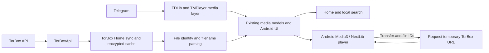

# Veylora

<p align="center"></p>

[](LICENSE) · [Android build workflow](.github/workflows/veylora-android-debug.yml) · [Upstream TMPlayer](https://github.com/dracu-lah/TMPlayer) · [Veylora repository](https://github.com/sivanandapvs/TMPlayer)

**Veylora is an independent Android derivative of [TMPlayer](https://github.com/dracu-lah/TMPlayer).** It retains TMPlayer's Telegram media and player foundation and adds an optional TorBox cloud library. One Android application has phone and Android TV launcher entries. This branch is an **integration build**, not a published Veylora release; live TorBox streaming and physical-device compatibility still need validation.

## About Veylora

TMPlayer's existing Telegram library, search, playback, navigation and local media features remain the foundation. Veylora adds TorBox account connection, cloud file discovery, a Home feed, local filename search and playback through the existing Android player. TorBox access requires the user's own API key and account. No content catalogue or indexer is bundled.

| Available in this branch | Scope |
| --- | --- |
| Telegram | Existing TDLib-based media access and phone/TV interface; developer-supplied Telegram app credentials are required for sign-in. |
| TorBox | Torrent, Usenet and web-download list endpoints; playable video files in Home and local search; file handoff to the existing player. |
| Playback | Existing Android Media3/NextLib engine, audio/subtitle controls, seeking and local progress; TorBox requests a fresh HTTPS link. |
| Packaging | `app.veylora.player` debug/release identity; separate `app.veylora.player.test` preview variant; four-ABI universal debug APK. |

## What Changed in Veylora

### TorBox integration

- [TorBoxApi](core/src/pureMain/kotlin/com/tmplayer/torbox/TorBoxApi.kt) calls account, `mylist` and `requestdl` endpoints through the existing HTTP transport. It supports torrents, Usenet and web downloads, bounded JSON parsing, offset pagination, duplicate file IDs, cache bypass, transient retry/backoff and distinct authentication/rate-limit errors. No undocumented relay-update endpoint is called.
- [TorBoxCredentials](app/src/main/java/com/tmplayer/torbox/TorBoxCredentials.kt) validates a key before replacement and stores it with Android Keystore AES/GCM and `AtomicFile` in the private no-backup directory. Encrypted provider snapshots are read on startup; the earlier cache format remains readable. A failed provider refresh leaves the prior snapshot, and a torrent still processing metadata retains its previously known files.
- [TorBoxHomeViewModel](app/src/main/java/com/tmplayer/torbox/TorBoxHomeViewModel.kt) refreshes each provider, converts supported video files into shared `MediaItem`s and passes them to Home's Recently added feed. Manual Home refresh forces a TorBox refresh; background checks are throttled.
- Each file carries its provider, transfer ID and **exact TorBox file ID** through [MediaIdentity](core/src/pureMain/kotlin/com/tmplayer/data/MediaIdentity.kt). [MediaName](core/src/pureMain/kotlin/com/tmplayer/data/MediaName.kt) cleans display titles while retaining filenames for search. [SeriesShelf](core/src/pureMain/kotlin/com/tmplayer/data/SeriesShelf.kt) groups episodes and copies; distinct files in one transfer keep distinct identities. Home and local search reuse shared media models. A complete TorBox Movies/TV tab is not implemented.
- [PlayerActivity](app/src/main/java/com/tmplayer/player/PlayerActivity.kt) requests a download URL for the selected transfer/file pair, then plays the HTTPS source with the existing Android renderers and controls. Cloud resume is local and account/file keyed; retry requests a new URL. Cloud downloads, cloud casting, automatic next episode, in-player cloud quality switching and live cloud playback validation remain open.

<details><summary>Data-flow and size limits</summary>

Home owns discovery; account settings manage the connection. The API requests up to 100 transfer rows per page and advances by the count actually returned, including when a server uses a smaller page. A successful empty result is distinct from an API failure. Files are deduplicated by provider, transfer ID and file ID; only recognized video extensions are indexed. Current parser limits are 32 MiB per response and 20,000 playable files per page; the encrypted cache is capped at 32 MiB per provider. These safety limits are not unlimited-account support. Search includes the original filename, but the TorBox **torrent name** is not separately indexed.

</details>

### TDLib fixes and Telegram compatibility

This branch **retains upstream TMPlayer's TDLib integration** and its existing `tdl-coroutines` dependency. It does not author or patch TDLib itself.

| Problem | Verified branch change | Effect |
| --- | --- | --- |
| A fork build may lack Telegram app credentials | [Gradle configuration](app/build.gradle.kts) accepts a paired `TG_API_ID`/`TG_API_HASH` from ignored `local.properties` or CI environment variables and validates both. | Credential-free compilation works; Telegram sign-in still requires valid developer credentials. |
| Cloud playback has no TDLib file or active Telegram session | [PlayerActivity](app/src/main/java/com/tmplayer/player/PlayerActivity.kt) routes TorBox HTTPS media separately and excludes cloud items from the TDLib session-ended exit path. | A Telegram session change does not automatically stop a cloud item. |
| Media from two providers must retain distinct IDs | [MediaIdentity](core/src/pureMain/kotlin/com/tmplayer/data/MediaIdentity.kt), `MediaItem` equality and [HomeRows](core/src/pureMain/kotlin/com/tmplayer/data/HomeRows.kt) separate provider identities before mixing Recently added entries. | Same-title files retain their provider and playback route. |

TDLib itself, Telegram authentication, streaming and most runtime stability work are inherited from TMPlayer. No Veylora-authored TDLib source or ABI patch was found in this branch. See [upstream audit](docs/VEYLORA-UPSTREAM-AUDIT.md) and [provenance](docs/VEYLORA-PROVENANCE.md).

### Branding, identity and UI

Android displays **Veylora** with a new V/play mark, launcher assets, TV banner, splash artwork and violet styling. Artwork is in [art/veylora](art/veylora/); [scripts/build-veylora-assets.py](scripts/build-veylora-assets.py) reproduces exports. The branch adds a TorBox account screen, cloud Home cards, provider labels, cloud series details and cloud-aware local search. Phone and TV layouts and most navigation remain TMPlayer work. A TV launcher is present; physical TV validation remains pending.

| Variant | Application ID | Notes |
| --- | --- | --- |
| Debug and release | `app.veylora.player` | Current `defaultConfig`; debug uses Android debug signing. |
| Preview | `app.veylora.player.test` | Release-derived test install with `-test` version suffix. |
| Promo | `app.veylora.player.promo` | Debug-derived demo/screenshot variant. |

The Kotlin namespace remains `com.tmplayer`. The changed application ID installs separately from upstream `com.tmplayer` and does not automatically migrate upstream app data. Upstream update checks and support links are disabled in this development build.

### Player and multimedia

Android playback continues to use TMPlayer's Media3/NextLib player, track selectors, subtitles, seeking, hardware/software decode choices and external-player support. TorBox adds an HTTPS source to that player; it does not import TorBox-Cinema's player. The repository's [FFmpeg build script](scripts/build-media3ext.sh) and [decoder patch](scripts/media3ext/tmplayer-decoders.patch) are inherited TMPlayer work. Veylora's Android workflow builds and checks that custom NextLib AAR. An ordinary local debug build can use the Maven AAR **without** the extra patched decoders. Desktop MPV support is inherited from TMPlayer and is not a completed TorBox desktop integration. See [third-party notices](THIRD_PARTY_NOTICES.md).

Android also supports direct playback of Stored videos inside raw split ZIP archives named `.zip.001`, `.zip.002`, and so on. See [split ZIP playback and its limits](docs/SPLIT-ZIP.md).

## Technical architecture



Shared `:core` holds identities, parsing, grouping and API parsing; `:ui` holds shared Compose presentation and search state; `:app` holds Android credentials, Home sync, account settings and playback. Telegram continues through TDLib. TorBox uses its own HTTP/API path and enters selected shared Home/search models. There is no unified remote backend.

The earlier [integration map and handoff notes](docs/VEYLORA-INTEGRATION.md) provide more implementation context; they describe an earlier checkpoint where later sync changes were not yet present.

## Feature comparison

| Area | Original TMPlayer | Veylora additions |
| --- | --- | --- |
| Telegram | TDLib access, authentication, library and streaming | Fork/CI credential configuration; provider-aware mixed Home and cloud session separation. |
| TorBox | No TorBox provider | Account connection, encrypted snapshots, file discovery, Home/search integration and file-ID playback handoff. |
| Application identity | TMPlayer branding and `com.tmplayer` | Veylora assets and `app.veylora.player`; `.test` preview and `.promo` variants. |
| Multimedia | Media3/NextLib, FFmpeg build scripts, Android player; desktop MPV | TorBox HTTPS playback in Android and CI checks for the custom FFmpeg AAR. |
| UI | Phone/TV navigation, Home, search and details | TorBox settings and Home cards, provider labels and Veylora branding. |
| Build | Gradle Android and desktop infrastructure | Veylora Android workflow, identity/launcher checks and four-ABI universal debug build. |

## Build, installation and testing

Use **JDK 21**, Android SDK platform 37, Build Tools 36.0.0 and the checked-in Gradle wrapper. The custom FFmpeg build also requires NDK 25.2.9519653 and CMake 3.22.1, as configured in [the Android workflow](.github/workflows/veylora-android-debug.yml). See [BUILDING.md](docs/BUILDING.md) for the wider upstream build process.

Add `sdk.dir` to ignored `local.properties`. For Telegram sign-in, add your own `TG_API_ID` and `TG_API_HASH` from [Telegram](https://my.telegram.org); leave both unset for a credential-free build. Do not commit these values. TorBox credentials are entered inside the app.

```powershell
.\gradlew.bat :core:jvmTest :ui:jvmTest :app:testDebugUnitTest :app:assembleDebug --max-workers=2
```

On Unix-like systems use `./gradlew` with the same tasks. Debug output is `app/build/outputs/apk/debug/app-debug.apk`, signed with the local debug key. It includes native libraries for `armeabi-v7a`, `arm64-v8a`, `x86` and `x86_64`. Build a release-derived test install with `:app:assemblePreview`. For **extra patched decoders**, build `scripts/build-media3ext.sh` first and pass `-PtmRequireMedia3ext=true`; an ordinary debug APK must not be described as having them unless that AAR exists locally.

The default local version is `1.28.1` (version code `1280199`); Gradle properties can override it for a build.

The [Veylora Android workflow](.github/workflows/veylora-android-debug.yml) is configured to build the custom AAR, assemble and verify an APK, run unit tests and upload artifacts. Its presence does not imply every run passes. Focused local TorBox, filename and search tests passed during development; broader regression suites have reported failures. [The dated build report](docs/VEYLORA-REPORT.md) and [pending list](docs/VEYLORA-PENDING.md) describe an older checkpoint and retain historical package/cache details; current Gradle and source files govern present behavior.

## Privacy and security

TorBox API keys and library snapshots are encrypted locally. Playback sends the key to TorBox as required by its API, obtains a temporary HTTPS link and does not store the signed URL in resume preferences. Telegram and optional metadata/subtitle providers retain their own upstream data flows. See [Veylora development privacy notes](docs/VEYLORA-PRIVACY.md) and [SECURITY.md](SECURITY.md). No Veylora privacy operator or release service is configured here.

## Development History

| Date | Milestone | Evidence |
| --- | --- | --- |
| Before 9 Nov 2026 | TMPlayer foundation at upstream base `b4e93bf9`: Telegram, UI, player and build system. | [Original TMPlayer](https://github.com/dracu-lah/TMPlayer) |
| 9 Nov 2026 | Veylora branding, TorBox API/account groundwork, encrypted cache and player recovery; Android CI and custom FFmpeg workflow started. | [`90f983df`](https://github.com/sivanandapvs/TMPlayer/commit/90f983df), [`62d19de7`](https://github.com/sivanandapvs/TMPlayer/commit/62d19de7), [`0dd490ed`](https://github.com/sivanandapvs/TMPlayer/commit/0dd490ed) |
| 10 Nov 2026 | Provider-specific identities, mixed Recently added feed, TorBox player handoff and Home/series fixes. | [`3b2176b4`](https://github.com/sivanandapvs/TMPlayer/commit/3b2176b4), [`e224afbf`](https://github.com/sivanandapvs/TMPlayer/commit/e224afbf), [`9a20cd27`](https://github.com/sivanandapvs/TMPlayer/commit/9a20cd27) |
| 11 Nov 2026 | `app.veylora.player` identity and CI build configuration corrected. | [`a0777938`](https://github.com/sivanandapvs/TMPlayer/commit/a0777938), [`d45b6a31`](https://github.com/sivanandapvs/TMPlayer/commit/d45b6a31) |
| 12 Nov 2026 | CI FFmpeg dependency retry committed. The current working tree additionally contains uncommitted pagination, cache, filename, search and manual-refresh fixes, with local tests and a universal debug APK. | [`710478c6`](https://github.com/sivanandapvs/TMPlayer/commit/710478c6); local changes are not yet committed |

No branch commit establishes a Veylora-authored TDLib source patch; TDLib-related changes here are app configuration and coexistence with cloud playback.

## Known limitations and roadmap

- Live TorBox authentication, decoding, seeking, audio/subtitle tracks and process-death behavior still require account and device testing.
- TorBox is surfaced in Home and local search. Dedicated complete cloud Movies/TV libraries, original torrent-name search and complete all-provider search parity are not established.
- Cloud downloads/offline copies, casting, automatic next episode, in-player quality switching, cross-device cloud resume and desktop/web TorBox screens remain unimplemented.
- Release/R8, installation/upgrade and physical TV validation remain separate from a locally verified debug build. The custom AAR is required for extra patched decoders.
- Broad test failures still need triage against a clean upstream baseline. The [pending-work document](docs/VEYLORA-PENDING.md) is a dated checkpoint and may contain stale identity/cache descriptions.

## Contributors and acknowledgements

### Original project – TMPlayer

**TMPlayer original developer dracu-lah and contributors** · [Original repository](https://github.com/dracu-lah/TMPlayer)

Veylora is derived from TMPlayer. Its original author and contributors retain their copyrights and credit for the Telegram client, player, phone/TV interface, build foundation and upstream improvements. Git history and original notices are retained; this fork does not claim authorship of that work.

Original project website: [tmplayer.org](https://tmplayer.org/). Its [legal information](https://tmplayer.org/legal/) describes upstream TMPlayer, not a Veylora operator.

### Veylora development and additional engineering

**PVS Sivananda – Veylora integration, additional development and project maintenance** · [Veylora repository](https://github.com/sivanandapvs/TMPlayer)

The branch records additional work integrating TorBox APIs and media discovery, connecting cloud files to Home/search/playback, securing credentials, adding provider identities and local cloud resume, investigating TDLib coexistence, rebranding Android, changing the application ID, maintaining phone/TV assets and navigation, configuring custom FFmpeg CI, debugging, regression testing and documentation. These are modifications on top of TMPlayer and do not transfer ownership of inherited code or upstream multimedia patches.

### AI development assistance

**OpenAI Codex** and **Anthropic Claude** are acknowledged as development assistants for code analysis, debugging, implementation and test assistance, documentation and development workflows. They are not copyright holders, maintainers or substitutes for the original authors and human contributors. The original TMPlayer code is credited to its original authors, not to AI tools.

### Third-party projects

[TDLib](https://github.com/tdlib/td), [TorBox](https://torbox.app/), [Android Media3](https://github.com/androidx/media), [NextLib](https://github.com/anilbeesetti/nextlib), [FFmpeg](https://ffmpeg.org/), [AndroidX](https://developer.android.com/jetpack/androidx), [Jetpack Compose](https://developer.android.com/compose) and components in [THIRD_PARTY_NOTICES.md](THIRD_PARTY_NOTICES.md) belong to their respective authors and have their own licences. The existing desktop MPV integration uses [libmpv](https://mpv.io/).

## Licence and legal notices

Veylora remains a **GPL-3.0-or-later** derivative of TMPlayer. Preserve the [licence](LICENSE), [OpenSSL additional permission](LICENSE-OPENSSL-EXCEPTION.md), [third-party notices](THIRD_PARTY_NOTICES.md), original copyright headers and corresponding-source obligations. Retained player artwork in `art/player.svg` is credited to [SVG Repo](https://www.svgrepo.com); Veylora artwork provenance is documented [here](docs/VEYLORA-PROVENANCE.md). Veylora is independent of Telegram and TorBox and is not an official client of either service.

Original TMPlayer notice: **GPL-3.0-or-later, © 2026 dracu-lah**, subject to the original authors' copyrights and the repository's OpenSSL additional permission.
